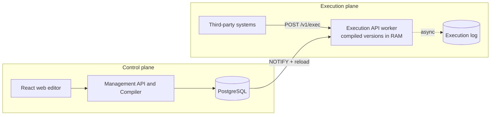
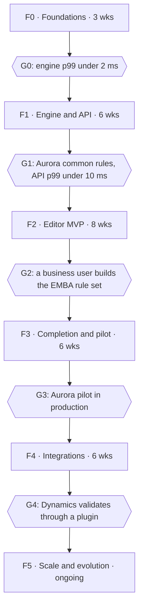

# Minos — Specification and Roadmap

Version 0.1 · 16 November 2026 · albegali

## Summary and goals

We are building a "JSON-in / JSON-out" rule engine that evaluates an object against a versioned rule graph, with an n8n-style visual editor and synchronous APIs under 10 ms (p99) on the engine side. The key choice: rules are designed and saved in PostgreSQL, but they are **compiled** and executed entirely **in memory** in the API workers, so the database is never on the hot path.

**Goals**

1. Define several independent *Rule Sets*, each bound to an entity and its schema (e.g. `StudyPlan`, `Enrollment`).
2. Compose rules into a graph: conditions, nested AND/OR/NOT groups, decision tables, branches, early exits.
3. Return an outcome (`pass` / `fail` / `skip` / `error`) and structured feedback for every step, both at the exit point and, optionally, on the steps that passed.
4. Version every publication immutably, with environments (draft, test, prod) and instant rollback.
5. Generate the schema from a sample JSON, by hand, or from connectors (Dataverse, SQL, NoSQL) added later.
6. Expose REST APIs for third-party systems (Dynamics, portals, ETL) and a low-code drag-and-drop editor.

**Out of scope (v1):** running long or asynchronous stateful workflows (full n8n style), writing to external systems, a forward-chaining inference engine (Rete/Drools style).

**Glossary**

| Term | Meaning |
| --- | --- |
| Workspace | Multi-tenant container (e.g. a university, a business unit) |
| Entity / Schema | Data model of the input object, expressed in JSON Schema 2020-12, versioned |
| Rule Set | Set of rules for an entity, with a graph and an API key (`ruleset_key`) |
| Rule Graph | Directed acyclic graph (DAG) of nodes connected by edges |
| Node | Processing unit: JSON input, JSON output, outcome |
| Version | Immutable, compiled snapshot of the Rule Graph plus the schema reference |
| Release / Alias | Movable pointer from an environment (`prod`, `test`) to a version |
| Trace | Step-by-step record of an execution: visited nodes, outcomes, feedback, timings |
| Context | JSON document flowing through the graph: `input`, `vars`, `feedback`, `result` |

## Similar tools and what to adopt

No existing tool covers Python, an n8n-style editor, schema-first design and per-step feedback all together; the closest reference is GoRules, from which we take the JSON graph format. The analysis is based on public knowledge of the projects: versions and licences must be re-checked at kickoff.

| Tool | How it is built | What we take | Limit for us |
| --- | --- | --- | --- |
| [GoRules (Zen Engine + JDM Editor)](https://github.com/gorules/zen) | JSON graph (JDM) with Input, Decision Table, Expression, Switch, Function nodes; Rust core with Python bindings; open-source React editor | JSON graph format, decision tables with hit policies, React editor based on React Flow, in-browser simulator | Per-step feedback and schema-first not native; custom logic in JS |
| [Drools / KIE + DMN](https://www.drools.org/) | Rete engine (forward chaining) on the JVM; OMG standard DMN with the FEEL language | DMN decision tables and hit policies (FIRST, UNIQUE, COLLECT), the decision service concept | JVM, steep learning curve, editor not n8n-like |
| [json-rules-engine](https://github.com/CacheControl/json-rules-engine) | JSON rules with nested `all`/`any`/`not`, lazily resolved facts, priorities, events | JSON syntax for nested conditions, "facts" computed on demand, success/failure events | Node.js, no graph or editor |
| [Microsoft RulesEngine](https://github.com/microsoft/RulesEngine) | JSON rule workflows with C# lambda expressions, nested rules, OnSuccess/OnFailure actions | Success/error messages per rule, nested rules with an operator, workflows by name | .NET; no official visual editor |
| [n8n](https://n8n.io/) | Node editor (Vue), data as arrays of JSON items between nodes, nodes as plugins with a declarative descriptor | Canvas UX, per-node input/output panel, nodes as plugins with a manifest, separate credentials | Built for workflows and integrations, not sub-ms validation |
| [Node-RED](https://nodered.org/) | JSON flows, `msg` messages between nodes, extensible palette | Exportable flow format, palette by category | Node.js runtime, no native versioning |
| [JsonLogic](https://jsonlogic.com/) | Rules as a JSON AST (`{"and":[...]}`), implementations in many languages | Serialisable, portable AST representation of conditions | Boolean expressions only, no feedback |
| [CEL (Common Expression Language)](https://cel.dev/) | Non-Turing-complete expression language, type-checked against a schema, compiled | Type-checking expressions against the schema at publication time, safety (no infinite loops) | Textual syntax, not very no-code |
| [Open Policy Agent (Rego)](https://www.openpolicyagent.org/) | Declarative policies, versioned bundles distributed to nodes, in-memory evaluation | The "immutable bundle + in-memory cache + hot reload" distribution model | Rego is hard for business users |
| [React Flow (xyflow)](https://reactflow.dev/) | React library for node canvases | Editor foundation: custom nodes, minimap, zoom, auto-layout with ELK/dagre | UI only |

**Decisions derived from the analysis**

- Graph format inspired by GoRules' JDM, extended with outcomes, feedback and logical groups.
- Conditions as a JSON AST (JsonLogic style) generated by the editor, plus a textual expression language for expert users, both compiled to Python.
- Type-checking of expressions against the schema at publication time, like CEL.
- Decision tables with DMN hit policies.
- Distribution like OPA: an immutable compiled version, loaded in memory, hot reloaded on notification.
- Editor on React Flow with n8n UX: per-node I/O panel, trial runs, plugin palette.
- Evaluate `zen-engine` (GoRules' Python binding) as an alternative engine for decision tables if the pure-Python engine benchmarks fall short.

## Functional requirements

Every requirement has a code for traceability in tickets and acceptance tests.

### Workspaces, entities and rule sets

- **RF-01** Several isolated workspaces (multi-tenant), with users and roles per workspace.
- **RF-02** Several entities per workspace; every entity has versioned schemas.
- **RF-03** Several rule sets per entity (e.g. `aurora.studyplan.executive-mba`, `aurora.studyplan.master-full-time`).
- **RF-04** A rule set can call another one as a subgraph (*Sub-RuleSet* node), to reuse common blocks such as "personal data checks".
- **RF-05** Top-level router: a "dispatcher" rule set chooses the rule set to run based on a field (e.g. `program.code`). Built with a `switch` and `subruleset` nodes, without a dedicated concept.

### Schema

- **RF-10** Schema in JSON Schema 2020-12, with nested objects, arrays of objects, enums, formats (`date`, `email`), required fields, UI metadata (label, description, example).
- **RF-11** Inference from one or more sample JSONs: types, nested objects, arrays, recognised formats (ISO dates, email, UUID); merging several samples to infer optional fields.
- **RF-12** Tree-based manual schema editor, with JSON Schema import/export.
- **RF-13** Plugin-based `SchemaConnector` interface to derive the schema from external sources: Dataverse (entity metadata API), SQL (information\_schema), MongoDB (document sampling), OpenAPI. Implementations after v1.
- **RF-14** Schema versioning with diff and compatibility analysis: reports which rule sets a change breaks (field removed, type changed).
- **RF-15** Optional structural validation of the input against the schema as the first node of the graph.

### Rule graph and nodes

- **RF-20** The graph is a DAG with one *Start* node and one or more *End* nodes; cycles are forbidden and detected at publication.
- **RF-21** v1 node types:
  - *Condition*: one or more conditions on schema paths, with typed operators.
  - *Group*: AND / OR / NOT nestable to any depth, in short-circuit or "evaluate everything" mode.
  - *Decision Table*: rule rows with FIRST, UNIQUE, PRIORITY, COLLECT hit policies.
  - *Switch*: multiple branches based on expressions, with a default branch.
  - *Expression / Set*: computes derived variables (e.g. total credits) and writes them to the context.
  - *For Each*: applies a subgraph to every item of an array (e.g. every exam in the plan) with `all` / `any` / `count` aggregation.
  - *Lookup*: static reference table versioned with the rule set (e.g. price list per programme).
  - *Sub-RuleSet*: invokes another rule set at a pinned version.
  - *Feedback*: emits a message without changing the flow.
  - *End*: terminates with an outcome (`valid`, `invalid`, `warning`) and output mapping.
- **RF-22** Operators: comparison, `in` / `not in`, `between`, `contains`, `starts_with`, `regex`, `is_null`, `exists`, dates (`before`, `after`, `within_days`, `age`), arrays (`any`, `all`, `count`, `sum`, `min`, `max`, `distinct`).
- **RF-23** Typed references: `$.input.student.program.code`, `$.vars.totalCfu`, `$.output.<nodeId>`, constants, environment parameters (e.g. reference date).
- **RF-24** Functions extensible through registered Python plugins (whitelist), never arbitrary user-supplied code in v1.

### Flow, exit and feedback

- **RF-30** Every node produces an outcome: `pass`, `fail`, `skip`, `error`.
- **RF-31** Every node has a configurable failure policy: `stop` (exit immediately), `continue` (record the error and go on), `branch` (follow the `onFail` edge).
- **RF-32** Execution mode per rule set: `fail_fast` (first blocking violation) or `collect_all` (collects every violation, useful for forms).
- **RF-33** Structured feedback: `code`, `severity` (`info`, `warning`, `error`), `message` with templates and localisation (it, en), `path` of the field involved, `nodeId`, extra `data`.
- **RF-34** Optional feedback on success too, enabled per node (`emitOnPass`).
- **RF-35** The exit point is always reported: `exitNodeId`, reason, full path of visited nodes.
- **RF-36** Trace level selectable per call: `none`, `summary`, `full` (with every node's input and output).

### Versioning and lifecycle

- **RF-40** States: `draft` (editable), `published` (immutable, semver-numbered), `deprecated`, `archived`.
- **RF-41** Per-environment aliases (`dev`, `test`, `prod`) pointing to a version; promotion and rollback = moving the alias, no deploy.
- **RF-42** Effective dates: every environment has a schedule of versions with a start date (e.g. rules for academic year 2027/28 from 1 August); the request's reference date picks the version.
- **RF-43** Diff between versions (and against the draft); audit log of who published what and when.
- **RF-44** ~~Four-eyes approval~~: not planned while there are no users (open installation).
- **RF-45** Import/export of the complete rule set (graph, schema, lookups, tests) as a JSON bundle, for Git and for moving between environments.

### Tests

- **RF-50** Test cases per rule set: JSON input and expected output; run on every publication, which fails if a test fails.
- **RF-51** Simulator in the editor: runs the draft on an input and shows the path highlighted on the canvas.
- **RF-52** Replay: re-run recorded real requests against a new version and compare the outcomes ("shadow run").

### Integration

- **RF-60** REST APIs for synchronous and batch execution, management APIs, generated OpenAPI 3.1.
- **RF-61** Optional authentication with scoped API keys (off by default: open local installation).
- **RF-62** Outbound integration connectors from v2: Power Platform custom connector, Dataverse plugin that calls the API on pre-operation events, webhooks.
- **RF-63** *Data Fetch* node (v3): enriches the context by reading from a connector, with cache and timeout, off the zero-latency path.

## Non-functional requirements

The constraint that drives the architecture is latency: the engine must evaluate a typical rule set in under 1 ms, so that the time the caller perceives is dominated by the network.

| Code | Requirement | v1 target |
| --- | --- | --- |
| RNF-01 | Engine latency (evaluation only), rule set of \~100 nodes, 10 KB input | p50 < 0.5 ms, p99 < 2 ms |
| RNF-02 | End-to-end API latency measured on the server (parse, auth, evaluation, serialisation) | p99 < 10 ms |
| RNF-03 | Throughput per core | ≥ 1,500 requests/s on a typical rule set |
| RNF-04 | Propagation of a new publication or alias change to every worker | < 2 s |
| RNF-05 | Execution API availability | 99.9% monthly; execution keeps working with the DB unreachable, using the versions already in memory |
| RNF-06 | Input size | max 1 MB (configurable), max depth 32 levels |
| RNF-07 | Determinism | same input + same version + same reference date = same output |
| RNF-08 | Security | no `eval` of user code; expressions compiled from a whitelisted AST; step and time limits per execution (e.g. 50 ms) |
| RNF-09 | Authentication and authorisation | Optional and off by default (free software for local installations, without sensitive data); when on, 256-bit API keys stored as SHA-256, with scopes (ADR 0005). No user login or roles planned |
| RNF-10 | Personal data | traces and logs mask fields marked `pii` in the schema; configurable retention (default 30 days); EU hosting for GDPR |
| RNF-11 | Observability | OpenTelemetry (traces, metrics, logs), per-rule-set metrics: calls, outcomes, latencies, most frequent exit nodes |
| RNF-12 | Editor accessibility | WCAG 2.2 AA for panels and forms; keyboard-navigable canvas |
| RNF-13 | Localisation | UI and feedback messages in Italian and English |
| RNF-14 | Code quality | ≥ 85% test coverage on the engine, strict type-checking (mypy/pyright, TypeScript strict), CI with regression benchmarks |

Network latency between caller and API is not under our control: to get a perceived "\~0", the service must be deployed in the same cloud region as the main callers (e.g. the Azure region of Dynamics).

## Architecture and stack

The architecture separates a **control plane** (editor, management API, PostgreSQL) from an **execution plane** (stateless workers that keep the compiled versions in RAM). The hot path of a call touches neither the database nor the internal network.



A publication writes to PostgreSQL and sends a NOTIFY: the workers reload only the version that changed, while third-party calls keep being served from RAM.

### Components

1. **Web editor (React)**: canvas, schema editor, simulator, version management.
2. **Management API (FastAPI)**: CRUD of workspaces, entities, schemas, rule sets, drafts, tests, publication, aliases, users.
3. **Compiler**: validates the graph (DAG, types against the schema, reachable nodes), runs the tests, produces a *compiled artefact* (canonical JSON + SHA-256 hash) and saves it.
4. **Execution API (FastAPI, separate process)**: loads the artefacts, turns them into an executable plan (prebuilt Python closures), evaluates requests.
5. **PostgreSQL**: source of truth for everything, compiled artefacts included (JSONB/BYTEA).
6. **Notification channel**: PostgreSQL `LISTEN/NOTIFY` in v1; Redis Pub/Sub or NATS only if several regions are needed.
7. **Trace store**: table partitioned by day in PostgreSQL (v1), movable to ClickHouse or object storage if volumes grow.

### Rule storage: recommendation

**Recommendation: PostgreSQL as the source of truth + in-memory cache in the workers + invalidation via LISTEN/NOTIFY.** It is the cheapest option (a single managed database, no mandatory Redis) and the fastest: a read from a Python dictionary in RAM costs nanoseconds, while any remote store adds 0.3–1 ms per call.

How it works: on startup the worker loads the artefacts of the active aliases; on `NOTIFY ruleset_published` it reloads only the one that changed and swaps the pointer atomically; a poll of the alias hashes every 30 s covers lost notifications. In-flight requests finish on the version they started with.

| Option | Rule read latency | Indicative cost | Assessment |
| --- | --- | --- | --- |
| **PostgreSQL + RAM cache (recommended)** | \~0 (RAM), DB only on reload | one small managed instance, \~€50–150/month | Transactions, JSONB, versioning and audit in one place; zero hops on the hot path |
| Redis as the primary store | 0.2–1 ms per call | +1 managed service | Slower than local RAM, weak durability and relational queries |
| MongoDB / Cosmos DB | 1–5 ms per call if read on every request | medium-high (RU/cluster) | Handy for JSON documents, but a cache is needed anyway; less suited to audit and constraints |
| Object storage (S3/Blob) with bundles | \~0 after loading | very low | Great as a multi-region distribution channel (OPA style) in phase 2; not suited to editing |
| SQLite embedded in the worker | \~0 | none | Good for edge/offline, but sync between instances has to be built |

Costs are order-of-magnitude estimates to validate with the chosen cloud. With several regions, the compiler also publishes the bundle to object storage and remote workers download it: same logic, different distribution.

### Technology stack

| Layer | Choice | Notes |
| --- | --- | --- |
| Backend language | Python 3.14 | Python has no LTS branch: 3.14 is the latest stable release with a mature ecosystem, supported until October 2030; evaluate 3.15 in mid-2027 |
| API framework | FastAPI + Pydantic v2 | Automatic OpenAPI 3.1 |
| ASGI server | Granian or Uvicorn, one worker per core | Benchmark in phase 0 |
| Serialisation | orjson / msgspec | 3–10 times faster than the standard `json` |
| Schema validation | `jsonschema-rs` (Rust binding) or `fastjsonschema` | Schema compiled once per version |
| ORM and migrations | SQLAlchemy 2 (async) + Alembic | Control plane only |
| Database | Managed PostgreSQL 17 or 18 | Azure Database for PostgreSQL in a Microsoft context |
| Frontend | React 19 + TypeScript 5 + Vite | Node.js 24 LTS for the toolchain |
| Canvas | React Flow (xyflow) + ELK.js for auto-layout | Also the foundation of GoRules and many no-code editors |
| UI state and data | Zustand + TanStack Query | API client generated from OpenAPI |
| Code/expression editor | Monaco Editor | Path autocompletion from the schema |
| UI kit | shadcn/ui (Radix) + Tailwind, or Fluent UI 2 for consistency with Dynamics | Open decision |
| Packaging | Docker, deployed on Azure Container Apps / Kubernetes | IaC with Terraform or Bicep |
| Observability | OpenTelemetry → Grafana / Azure Monitor |  |

### The execution engine

- **Compilation, not interpretation**: every node becomes a Python function closed over its own parameters; schema paths become precomputed accessors; the graph becomes a topologically sorted list. No parsing at runtime.
- **Expressions**: JSON AST → Python closures. The textual language for expert users is parsed with Lark in the compiler, never at runtime.
- **Immutable context per node**: every node receives JSON and returns JSON (a design requirement), but internally native structures are used and serialisation happens only on output or with a `full` trace, so as not to pay for a copy at every step.
- **Performance plan B**: if the benchmarks on large rule sets fall short, the evaluation core can be rewritten in Rust with PyO3 keeping the same format, or decision tables can be delegated to `zen-engine`.

## Data model and JSON format

Everything the user designs is a JSON document ("Rule Graph Document", RGD) saved as JSONB; relational tables are used only for identity, versions, permissions and audit.

### Main tables (PostgreSQL)

| Table | Key fields | Notes |
| --- | --- | --- |
| `workspace` | id, slug, name, settings | Tenant |
| `entity` | id, workspace\_id, key, name | E.g. `StudyPlan` |
| `schema_version` | id, entity\_id, version, json\_schema (JSONB), source (`sample` / `manual` / `connector`), hash | Immutable after publication |
| `ruleset` | id, entity\_id, key, name, mode (`fail_fast` / `collect_all`) | `key` used in the execution URL |
| `ruleset_draft` | ruleset\_id, graph (JSONB), updated\_by, lock\_version | One draft per rule set, optimistic locking |
| `ruleset_version` | id, ruleset\_id, semver, schema\_version\_id, graph (JSONB), compiled (JSONB), hash, valid\_from, valid\_to, status, published\_by, published\_at | Immutable |
| `ruleset_alias` | ruleset\_id, env, version\_id | `prod` → 1.4.0; updating it triggers the NOTIFY |
| `lookup_table` | id, ruleset\_version\_id, key, rows (JSONB) | Versioned with the rule set |
| `test_case` | id, ruleset\_id, name, input, expected | Run on publication |
| `api_client` | id, workspace\_id, key\_hash, scopes, rate\_limit | Hashed API keys |
| `execution_log` | id, ts, ruleset\_version\_id, outcome, exit\_node, latency\_us, input\_hash, trace (JSONB, optional) | Partitioned by day |
| `audit_event` | id, ts, actor, action, target, diff | Append-only |

### Rule Graph Document

```json
{
  "rgdVersion": "1.0",
  "ruleset": "aurora.studyplan.emba",
  "schemaRef": { "entity": "StudyPlan", "version": 3 },
  "settings": { "mode": "collect_all", "locale": "it", "maxSteps": 5000 },
  "nodes": [
    { "id": "start", "type": "start" },
    {
      "id": "chkWindow",
      "type": "condition",
      "label": "Plan submitted within the window",
      "condition": {
        "op": "between",
        "left": { "ref": "$.input.submittedAt" },
        "right": [ { "ref": "$.vars.window.open" }, { "ref": "$.vars.window.close" } ]
      },
      "onFail": "stop",
      "feedback": {
        "fail": { "code": "SP_WINDOW_CLOSED", "severity": "error", "path": "submittedAt",
                  "message": { "it": "Finestra chiusa il {{vars.window.close}}", "en": "Window closed on {{vars.window.close}}" } },
        "pass": null
      }
    },
    {
      "id": "grpCfu",
      "type": "group",
      "operator": "and",
      "evaluate": "all",
      "children": [
        { "op": ">=", "left": { "fn": "sum", "args": [ { "ref": "$.input.courses[*].cfu" } ] }, "right": 60 },
        { "op": "or", "args": [
          { "op": "==", "left": { "ref": "$.input.program.track" }, "right": "FINANCE" },
          { "op": "<=", "left": { "fn": "count", "args": [ { "ref": "$.input.courses[*]" } ], "where": { "op": "==", "left": { "ref": "$.item.area" }, "right": "FIN" } }, "right": 2 }
        ] }
      ],
      "onFail": "continue"
    },
    { "id": "endOk", "type": "end", "outcome": "valid" },
    { "id": "endKo", "type": "end", "outcome": "invalid" }
  ],
  "edges": [
    { "from": "start", "to": "chkWindow" },
    { "from": "chkWindow", "to": "grpCfu", "on": "pass" },
    { "from": "chkWindow", "to": "endKo", "on": "fail" },
    { "from": "grpCfu", "to": "endOk", "on": "pass" },
    { "from": "grpCfu", "to": "endKo", "on": "fail" }
  ],
  "ui": { "positions": { "start": [0, 0], "chkWindow": [240, 0] } }
}
```

Format rules: edges have a port (`pass`, `fail`, `default` or the name of a Switch case); conditions are ASTs with `op` and `ref` / `fn` / literal operands; the `ui` section is not part of the compiled hash, so moving a node does not create a new logical version.

### Context flowing between nodes

```json
{
  "input":    { "...": "original object, read-only" },
  "vars":     { "totalCfu": 64, "window": { "open": "2027-09-01", "close": "2027-10-15" } },
  "nodes":    { "chkWindow": { "outcome": "pass", "output": {} } },
  "feedback": [],
  "meta":     { "referenceDate": "2027-09-20", "version": "1.4.0", "requestId": "..." }
}
```

Every node reads from the context and writes only to its own `nodes.<id>.output` slot, to `vars` (Set nodes) or to `feedback`. This makes every step inspectable as JSON in the simulator, like n8n's input/output panel.

### Execution output

```json
{
  "requestId": "01JD9X...",
  "ruleset": "aurora.studyplan.emba",
  "version": "1.4.0",
  "outcome": "invalid",
  "exit": { "nodeId": "endKo", "reason": "grpCfu:fail" },
  "feedback": [
    { "code": "SP_CFU_MIN", "severity": "error", "path": "courses", "nodeId": "grpCfu",
      "message": "At least 60 ECTS are required, 54 found", "data": { "actual": 54, "required": 60 } }
  ],
  "result": { "totalCfu": 54, "tuitionFee": 38500 },
  "path": ["start", "chkWindow", "grpCfu", "endKo"],
  "trace": null,
  "timing": { "engineUs": 212 }
}
```

## API

Two separate surfaces: the execution API (public to third-party systems, optimised for latency) and the management API (used by the editor and CI). Both are versioned in the path (`/v1`) and described in OpenAPI 3.1.

### Execution

| Method and path | Purpose |
| --- | --- |
| `POST /v1/exec/{workspace}/{ruleset}` | Runs the `prod` alias (default) |
| `POST /v1/exec/{workspace}/{ruleset}@{env}` | Runs an alias (`test`, `dev`) |
| `POST /v1/exec/{workspace}/{ruleset}/versions/{semver}` | Runs a pinned version (reproducibility, audit) |
| `POST /v1/exec/{workspace}/{ruleset}/batch` (F4) | Up to 1,000 objects per call, array response |
| `POST /v1/exec/{workspace}/{entity}/dispatch` (F3) | Chooses the rule set with the entity's dispatcher |
| `GET /v1/health`, `GET /v1/ready` | Probes; `ready` only after the artefacts are loaded |

Request:

```json
{
  "input": { "studentId": "S123", "program": { "code": "EMBA" }, "courses": [] },
  "options": { "trace": "summary", "locale": "it", "referenceDate": "2027-09-20", "validateSchema": true }
}
```

Response rules:

- **HTTP 200** even when the outcome is `invalid`: validation succeeded, the object did not. The outcome is in the body (`outcome`).
- **400** input not matching the schema (with the list of JSON Schema errors), **401/403** authentication, **404** nonexistent rule set or alias, **413** input too large, **422** execution error (e.g. step limit), **429** rate limit.
- Headers: `X-Ruleset-Version`, `X-Request-Id`, `Server-Timing: engine;dur=0.21`.
- Naturally idempotent: execution has no side effects.

### Management (excerpt)

Actions are sub-resources with `POST` (e.g. `.../publish`). The full reference of what is
implemented is in [`docs/api.md`](api.md).

| Resource | Main endpoints |
| --- | --- |
| Entities and schemas | `GET/POST /v1/workspaces/{ws}/entities`, `POST .../entities/{entity}/schemas` (manual or from samples), `POST /v1/schemas/infer`; later, import from connectors and diff between versions |
| Rule sets | `GET/POST /v1/workspaces/{ws}/rulesets`, `GET/PUT .../rulesets/{rs}/draft` (with `If-Match`) |
| Lifecycle | `POST .../rulesets/{rs}/validate`, `/simulate`, `/publish` (semver bump), `PUT/DELETE .../aliases/{env}` |
| Tests | `GET/POST .../rulesets/{rs}/tests`, `DELETE .../tests/{name}`, `POST .../tests/run` |
| Bundles (F3) | export of a version and import of a complete rule set |
| Node catalogue (F2) | `GET /v1/node-types` (manifest of nodes and plugins, used by the editor for the palette) |
| Connectors (F4) | `GET /v1/connectors`, `POST /v1/connections`, `POST /v1/connections/{id}/test` |
| Access | `.../api-keys`, `POST /v1/admin/api-keys`, `.../audit` (keys are only needed with `MINOS_REQUIRE_AUTH=true`) |

### SDKs and integrations

- Clients generated from OpenAPI for Python, TypeScript and C# (the latter useful for Dataverse plugins).
- Power Platform custom connector to use the engine from Power Automate and Power Apps.
- Sample Dataverse plugin: on `PreOperation` of `Create/Update` it calls the API and, if `outcome=invalid`, throws `InvalidPluginExecutionException` with the feedback messages.

## No-code web editor

The editor borrows n8n's UX (canvas, palette, node panel with JSON input and output) but is "schema-aware": every field, operator and value offered comes from the entity schema, so business users never type paths by hand.

### Screens

1. **Workspace home**: entities, rule sets, alias status per environment, last-24-hours metrics.
2. **Schema studio**: field tree; "paste a sample JSON" for inference; import from connector; diff between versions; `pii` marking.
3. **Rule set canvas**:
   - palette on the left with node types grouped (Logic, Data, Flow, Output, Plugins);
   - drag-and-drop, connecting `pass` / `fail` ports, auto-layout, minimap, copy/paste of node groups, annotations;
   - nodes coloured by outcome during simulation, with the path highlighted.
4. **Node panel** (on the right or full screen like n8n): configuration, feedback per outcome, `onFail` policy; Input / Output tabs with the real JSON from the latest simulation.
5. **Visual condition builder**: "field – operator – value" rows with nested AND/OR groups (query-builder style), switchable to a textual expression mode with Monaco and autocompletion.
6. **Decision table editor**: spreadsheet-like grid, CSV/Excel import/export, checks for overlapping or missing rows.
7. **Simulator and tests**: JSON input or generated from the schema, draft execution, save as test case.
8. **Versions and releases**: history, visual graph diff, publish, promote, rollback, approvals.

### Embedding the editor

- `@minos/editor` package as a reusable React component, with props for the API base URL and token; publishable to a private registry.
- Embed mode through an iframe with postMessage, to host it in a Dynamics Model-driven App (web resource) or in other portals.
- No login: the Studio opens directly on open installations (the default) and asks for an API key only if the API requires one.

### Plugin extensibility (like the n8n palette)

Every node type is described by a JSON manifest served by `GET /v1/node-types`: name, icon, ports, parameter schema (JSON Schema) and UI hints. The editor generates the configuration form from the manifest automatically, so a new node or connector on the Python side appears in the palette without frontend changes.

## Examples

The engine is generic: the repository holds complete examples, with test suites, for four domains (`examples/`):

| Rule set | Domain | What it shows |
| --- | --- | --- |
| `aurora.studyplan.*` | University study plan | Rule groups, nested aggregations, switch, sub rule set at a pinned version, price-list table |
| `shop.order` | E-commerce order | Computed totals, per-line checks listing the non-compliant items, shipping table, coupon with a warning |
| `aurora.enrollment` | University enrollment | Input made of several entities (student, programme with its courses, plan; `examples/entities`): rules that compare them with each other |
| `bank.loan.eligibility` | Loan eligibility | Instalment and instalment-to-income ratio, `collect` table of rejection reasons, risk band |

### Detailed example: Aurora Business School study plan

A dispatcher reads `program.code` and routes the plan to the programme's rule set; every rule set reuses a common block and adds its own rules. All the numbers below (credits, dates, prices) are **illustrative** and must be replaced with the real regulations.

### Input object

```json
{
  "studentId": "S2027-00123",
  "academicYear": "2027/2028",
  "submittedAt": "2027-09-20T10:15:00Z",
  "program": { "code": "EMBA", "edition": "2027", "track": "FINANCE", "format": "PART_TIME" },
  "student": { "birthDate": "1990-04-12", "country": "IT", "scholarship": { "type": "MERIT", "percent": 20 } },
  "courses": [
    { "code": "FIN101", "area": "FIN", "cfu": 6, "type": "CORE", "term": 1 },
    { "code": "STR210", "area": "STR", "cfu": 4, "type": "ELECTIVE", "term": 2 }
  ],
  "payment": { "plan": "INSTALLMENTS", "installments": 3 }
}
```

The schema is obtained by pasting this sample into the Schema studio; then it is refined by hand (enums for `program.code` and `area`, `cfu` a positive integer, `birthDate` marked `pii`) or, later, imported from the study plan's Dataverse entity.

### Rule sets and rules

| Rule set | Block | Rule (example) | Node type | On failure |
| --- | --- | --- | --- | --- |
| `aurora.studyplan.common` | Window | `submittedAt` between the edition's opening and closing (from a Lookup per programme and year) | Condition + Lookup | stop |
| `aurora.studyplan.common` | Courses | Every course exists in the year's catalogue and is not duplicated | For Each + Lookup | continue |
| `aurora.studyplan.common` | Courses | All mandatory CORE courses present | Expression + Condition | continue |
| `aurora.studyplan.emba` | Credits | Total credits ≥ the programme minimum; electives ≤ maximum | Group AND | continue |
| `aurora.studyplan.emba` | Subject area | FINANCE track: at least N credits in the FIN area; otherwise max 2 FIN courses | Switch + Group OR | continue |
| `aurora.studyplan.emba` | Calendar | No course in a term after the end of the edition | For Each | continue |
| `aurora.studyplan.emba` | Price | Fee = programme list price − scholarship (%) + extra for electives over the threshold | Decision Table + Set | — (computation) |
| `aurora.studyplan.emba` | Payment | Instalments allowed depending on the programme (e.g. 1, 2 or 3) | Decision Table | continue |
| `aurora.studyplan.ftmba` | Credits / Areas | Full-Time MBA's own rules, same structure | as above | — |

With `mode: collect_all` the student portal receives in a single call every error to show in the form, plus the `result` with total credits and the computed fee. The same rule set, called by a Dataverse plugin in `fail_fast`, blocks saving the plan at the first error.

### Versioning in the real case

- The 2027/28 rules are version 2.0.0 with `valid_from = 2027-08-01`; the 2026/27 ones stay active for plans with an earlier reference date.
- A mid-year price-list fix becomes 2.0.1, tried in `test` with a replay of real requests and then promoted to `prod` by moving the alias.

## Roadmap

In about 23 weeks we reach the Aurora pilot in production (gate G3); the Dynamics integrations follow in another 6. Every phase closes only when its gate is passed.



The durations assume 2 backend developers, 2 frontend developers and a part-time PO/QA; with half the team they roughly double.

### Deliverables and acceptance criteria

1. **F0 · Foundations**
   - Monorepo (`backend/`, `frontend/`, `packages/editor/`), CI with lint, type-check, tests and benchmarks; ADRs on storage, expression language, UI kit.
   - Spike: compiling a graph to closures and comparing with `zen-engine` on the same case.
   - Gate G0: engine p99 under 2 ms on a synthetic 100-node graph with a 10 KB input.
2. **F1 · Engine and API**
   - RGD v1 format, compiler with cycle detection and type-checking against the schema, base nodes, `fail_fast` / `collect_all` modes, feedback and trace.
   - Exec API and Management API, PostgreSQL with migrations, immutable versions, aliases, hot reload with LISTEN/NOTIFY, schema inference from samples, API keys.
   - Gate G1: the Aurora common rules written by hand in JSON pass their tests; API p99 under 10 ms at 200 requests/s per core.
3. **F2 · Editor MVP**
   - Canvas, palette generated from manifests, condition builder with AND/OR groups, I/O panel, schema studio, simulator, publication and promotion.
   - Gate G2: in a usability test, a user from the academic office builds and publishes the EMBA rule set to `test` without help from developers.
4. **F3 · Completion and pilot**
   - Decision tables, For Each, Lookup, Sub-RuleSet, dispatcher, test cases required on publication, visual diff, approvals, OpenTelemetry, PII masking, i18n.
   - Gate G3: Aurora pilot in production with the SLOs (RNF-01, 02, 05) met for 4 consecutive weeks.
5. **F4 · Integrations**
   - `SchemaConnector` for Dataverse, SQL (PostgreSQL, SQL Server), MongoDB, OpenAPI; encrypted credential management.
   - Power Platform custom connector, reference Dataverse plugin, Python/TypeScript/C# SDKs, batch endpoint, replay and shadow run.
   - Gate G4: Dynamics validates study plans in production through a plugin.
6. **F5 · Scale and evolution** (backlog prioritised by metrics)
   - Multi-region bundle distribution on object storage, Data Fetch node with cache, Rust/PyO3 core if the benchmarks call for it, an AI assistant that proposes rules and tests from regulations in PDF, an internal marketplace of plugin nodes.

## Risks and open decisions

### Risks

| Risk | Impact | Mitigation |
| --- | --- | --- |
| Pure Python cannot hold the latency on large rule sets (thousands of nodes, long arrays) | RNF-01 target missed | Benchmarks in phase 0 and in CI; compilation to closures; plan B Rust/PyO3 or `zen-engine` |
| The expression language grows into a programming language | Security, maintainability | Closed grammar, no explicit loops, functions only from registered plugins |
| Business users build unreadable graphs | Errors and costly maintenance | Sub-RuleSets, collapsible groups, graph linting (dead nodes, always-true conditions), mandatory tests |
| Schema changes break rules in production | Runtime errors | Impact analysis on schema publication; every rule version points to a pinned schema version |
| Scope creep towards an n8n clone (workflows, write integrations) | Delays | v1 out-of-scope stated; Data Fetch node only in phase 4 |
| Students' personal data in traces and logs | GDPR | `full` trace off in prod by default, `pii` masking, short retention, EU hosting |
| Caches out of sync between workers | Different outcomes for the same call | Version hash in the response header, NOTIFY + safety polling, drift metric |

### Decisions

- [x] Hosting: local installation (`docker compose`), no cloud for now.
- [x] Licence and distribution: free software, MIT licence.
- [x] UI kit: Fluent UI 2 (ADR 0004).
- [x] Identity provider for the editor: none, authentication optional and off by default.
- [ ] Textual expression language: our own syntax on Lark or a subset compatible with CEL or FEEL.
- [ ] Expected volumes (requests/day, peaks during enrolment periods) to size workers and trace store.
- [ ] Who the first pilot user is (e.g. the Aurora academic office) and which real rule sets to bring in phase 2.
