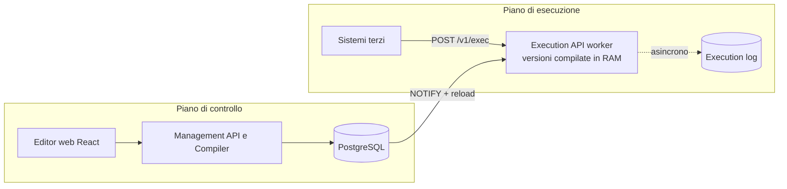
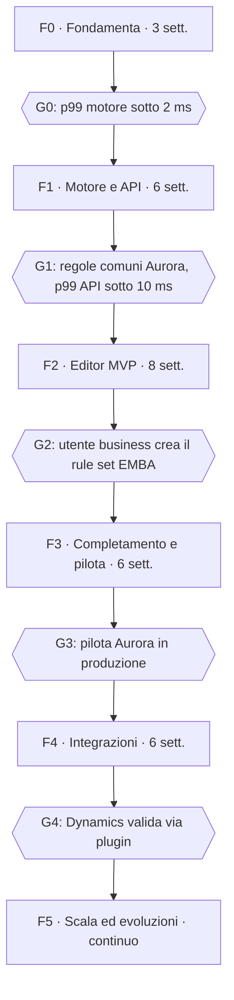

# Minos — Specifiche e Roadmap

Versione 0.1 · 16 novembre 2026 · albegali

## Sintesi e obiettivi

Costruiamo un motore di regole "JSON-in / JSON-out" che valuta un oggetto contro un grafo di regole versionato, con editor visuale stile n8n e API sincrone sotto i 10 ms (p99) lato motore. La scelta chiave: le regole si disegnano e si salvano su PostgreSQL, ma si **compilano** e si eseguono interamente **in memoria** nei worker API, quindi il database non è mai sul percorso caldo.

**Obiettivi**

1. Definire più *Rule Set* indipendenti, ciascuno legato a un'entità e al suo schema (es. `StudyPlan`, `Enrollment`).
2. Comporre regole in un grafo: condizioni, gruppi AND/OR/NOT annidati, tabelle decisionali, rami, uscite anticipate.
3. Restituire a ogni step un esito (`pass` / `fail` / `skip` / `error`) e feedback strutturati, sia sul punto di uscita sia, opzionalmente, sugli step superati.
4. Versionare in modo immutabile ogni pubblicazione, con ambienti (draft, test, prod) e rollback istantaneo.
5. Generare lo schema da un JSON di esempio, a mano o da connettori (Dataverse, SQL, NoSQL) aggiunti in seguito.
6. Esporre API REST per sistemi terzi (Dynamics, portali, ETL) e un editor low-code drag-and-drop.

**Fuori ambito (v1):** esecuzione di workflow lunghi o asincroni con stato (stile n8n completo), scrittura verso sistemi esterni, motore di inferenza a forward-chaining (stile Rete/Drools).

**Glossario**

| Termine | Significato |
| --- | --- |
| Workspace | Contenitore multi-tenant (es. un ateneo, una business unit) |
| Entità / Schema | Modello dati dell'oggetto in input, espresso in JSON Schema 2020-12, versionato |
| Rule Set | Insieme di regole per un'entità, con un grafo e una chiave API (`ruleset_key`) |
| Rule Graph | Grafo orientato aciclico (DAG) di nodi collegati da archi |
| Nodo | Unità di elaborazione: input JSON, output JSON, esito |
| Versione | Snapshot immutabile e compilato del Rule Graph più il riferimento allo schema |
| Release / Alias | Puntatore mobile da un ambiente (`prod`, `test`) a una versione |
| Trace | Registro step-by-step di un'esecuzione: nodi visitati, esiti, feedback, tempi |
| Context | Documento JSON che scorre nel grafo: `input`, `vars`, `feedback`, `result` |

## Strumenti simili e cosa adottare

Nessuno strumento esistente copre insieme Python, editor stile n8n, schema-first e feedback per step; il riferimento più vicino è GoRules, da cui prendiamo il formato a grafo JSON. L'analisi è basata sulla conoscenza pubblica dei progetti: versioni e licenze vanno riverificate al kickoff.

| Strumento | Come è implementato | Cosa prendiamo | Limite per noi |
| --- | --- | --- | --- |
| [GoRules (Zen Engine + JDM Editor)](https://github.com/gorules/zen) | Grafo JSON (JDM) con nodi Input, Decision Table, Expression, Switch, Function; core in Rust con binding Python; editor React open source | Formato a grafo JSON, decision table con hit policy, editor React basato su React Flow, simulatore nel browser | Feedback per step e schema-first non nativi; logica custom in JS |
| [Drools / KIE + DMN](https://www.drools.org/) | Motore Rete (forward chaining) su JVM; DMN standard OMG con linguaggio FEEL | Decision table DMN e hit policy (FIRST, UNIQUE, COLLECT), concetto di decision service | JVM, curva di apprendimento alta, editor non n8n-like |
| [json-rules-engine](https://github.com/CacheControl/json-rules-engine) | Regole in JSON con `all`/`any`/`not` annidati, fatti risolti in modo lazy, priorità, eventi | Sintassi JSON delle condizioni annidate, "fatti" calcolati on demand, eventi su successo/fallimento | Node.js, nessun grafo o editor |
| [Microsoft RulesEngine](https://github.com/microsoft/RulesEngine) | Workflow JSON di regole con espressioni lambda C#, regole annidate, azioni OnSuccess/OnFailure | Messaggi di successo/errore per regola, regole annidate con operatore, workflow per nome | .NET; nessun editor visuale ufficiale |
| [n8n](https://n8n.io/) | Editor a nodi (Vue), dati come array di item JSON tra nodi, nodi come plugin con descrittore dichiarativo | UX del canvas, pannello input/output per nodo, nodi come plugin con manifest, credenziali separate | Pensato per workflow e integrazioni, non per validazione sub-ms |
| [Node-RED](https://nodered.org/) | Flow JSON, messaggi `msg` tra nodi, palette estendibile | Formato flow esportabile, palette per categorie | Runtime Node.js, nessun versioning nativo |
| [JsonLogic](https://jsonlogic.com/) | Regole come AST JSON (`{"and":[...]}`), implementazioni in molti linguaggi | Rappresentazione AST serializzabile e portabile delle condizioni | Solo espressioni booleane, niente feedback |
| [CEL (Common Expression Language)](https://cel.dev/) | Linguaggio di espressioni non Turing-completo, type-checked rispetto a uno schema, compilato | Type-check delle espressioni contro lo schema in fase di pubblicazione, sicurezza (niente loop infiniti) | Sintassi testuale, poco no-code |
| [Open Policy Agent (Rego)](https://www.openpolicyagent.org/) | Policy dichiarative, bundle versionati distribuiti ai nodi, valutazione in memoria | Modello di distribuzione "bundle immutabile + cache in memoria + hot reload" | Rego è ostico per utenti business |
| [React Flow (xyflow)](https://reactflow.dev/) | Libreria React per canvas a nodi | Base dell'editor: nodi custom, minimap, zoom, auto-layout con ELK/dagre | Solo UI |

**Decisioni derivate dall'analisi**

- Formato del grafo ispirato al JDM di GoRules, esteso con esiti, feedback e gruppi logici.
- Condizioni come AST JSON (stile JsonLogic) generato dall'editor, più un linguaggio di espressioni testuale per utenti esperti, entrambi compilati in Python.
- Type-check delle espressioni sullo schema al momento della pubblicazione, come CEL.
- Decision table con hit policy DMN.
- Distribuzione come OPA: versione compilata immutabile, caricata in memoria, hot reload su notifica.
- Editor su React Flow con UX n8n: pannello I/O per nodo, esecuzione di prova, palette a plugin.
- Valutare `zen-engine` (binding Python di GoRules) come motore alternativo per le decision table se i benchmark del motore Python puro non bastano.

## Requisiti funzionali

Ogni requisito ha un codice per la tracciabilità nei ticket e nei test di accettazione.

### Workspace, entità e rule set

- **RF-01** Più workspace isolati (multi-tenant), con utenti e ruoli per workspace.
- **RF-02** Per ogni workspace, più entità; ogni entità ha schemi versionati.
- **RF-03** Per ogni entità, più rule set (es. `aurora.studyplan.executive-mba`, `aurora.studyplan.master-full-time`).
- **RF-04** Un rule set può richiamarne un altro come sotto-grafo (nodo *Sub-RuleSet*), per riusare blocchi comuni come "controlli anagrafici".
- **RF-05** Router di primo livello: un rule set "dispatcher" sceglie il rule set da eseguire in base a un campo (es. `program.code`).

### Schema

- **RF-10** Schema in JSON Schema 2020-12, con oggetti annidati, array di oggetti, enum, formati (`date`, `email`), obbligatorietà, metadati UI (label, descrizione, esempio).
- **RF-11** Inferenza da uno o più JSON di esempio: tipi, oggetti annidati, array, formati riconosciuti (date ISO, email, UUID); merge di più esempi per dedurre campi opzionali.
- **RF-12** Editor manuale dello schema ad albero, con import/export JSON Schema.
- **RF-13** Interfaccia `SchemaConnector` a plugin per derivare lo schema da sorgenti esterne: Dataverse (metadata API delle entità), SQL (information\_schema), MongoDB (campionamento documenti), OpenAPI. Implementazioni successive alla v1.
- **RF-14** Versioning dello schema con diff e analisi di compatibilità: segnala quali rule set rompe una modifica (campo rimosso, tipo cambiato).
- **RF-15** Validazione strutturale opzionale dell'input contro lo schema come primo nodo del grafo.

### Grafo di regole e nodi

- **RF-20** Il grafo è un DAG con un nodo *Start* e uno o più nodi *End*; i cicli sono vietati e rilevati alla pubblicazione.
- **RF-21** Tipi di nodo v1:
  - *Condition*: una o più condizioni su path dello schema, con operatori tipizzati.
  - *Group*: AND / OR / NOT annidabili a qualunque profondità, con modalità short-circuit o "valuta tutto".
  - *Decision Table*: righe di regole con hit policy FIRST, UNIQUE, PRIORITY, COLLECT.
  - *Switch*: rami multipli in base a espressioni, con ramo di default.
  - *Expression / Set*: calcola variabili derivate (es. somma CFU) e le scrive nel context.
  - *For Each*: applica un sotto-grafo a ogni elemento di un array (es. ogni esame del piano) con aggregazione `all` / `any` / `count`.
  - *Lookup*: tabella di riferimento statica versionata con il rule set (es. listino prezzi per programma).
  - *Sub-RuleSet*: invoca un altro rule set a versione fissata.
  - *Feedback*: emette un messaggio senza cambiare il flusso.
  - *End*: termina con esito (`valid`, `invalid`, `warning`) e mappatura dell'output.
- **RF-22** Operatori: confronto, `in` / `not in`, `between`, `contains`, `starts_with`, `regex`, `is_null`, `exists`, date (`before`, `after`, `within_days`, `age`), array (`any`, `all`, `count`, `sum`, `min`, `max`, `distinct`).
- **RF-23** Riferimenti tipizzati: `$.input.student.program.code`, `$.vars.totalCfu`, `$.output.<nodeId>`, costanti, parametri di ambiente (es. data di riferimento).
- **RF-24** Funzioni estendibili tramite plugin Python registrati (whitelist), mai codice arbitrario inserito dall'utente in v1.

### Flusso, uscita e feedback

- **RF-30** Ogni nodo produce un esito: `pass`, `fail`, `skip`, `error`.
- **RF-31** Per ogni nodo si configura la politica su fallimento: `stop` (esce subito), `continue` (accumula l'errore e prosegue), `branch` (segue l'arco `onFail`).
- **RF-32** Modalità di esecuzione per rule set: `fail_fast` (prima violazione bloccante) o `collect_all` (raccoglie tutte le violazioni, utile per i form).
- **RF-33** Feedback strutturato: `code`, `severity` (`info`, `warning`, `error`), `message` con template e localizzazione (it, en), `path` del campo coinvolto, `nodeId`, `data` aggiuntiva.
- **RF-34** Feedback opzionale anche su successo, abilitabile per nodo (`emitOnPass`).
- **RF-35** Il punto di uscita è sempre riportato: `exitNodeId`, motivo, path completo dei nodi visitati.
- **RF-36** Livello di trace richiedibile per chiamata: `none`, `summary`, `full` (con input e output di ogni nodo).

### Versioning e ciclo di vita

- **RF-40** Stati: `draft` (modificabile), `published` (immutabile, numerata semver), `deprecated`, `archived`.
- **RF-41** Alias per ambiente (`dev`, `test`, `prod`) che puntano a una versione; promozione e rollback = spostare l'alias, senza deploy.
- **RF-42** Validità temporale opzionale: una versione vale dal / al (es. regole per l'anno accademico 2027/28), selezionata con la data di riferimento della richiesta.
- **RF-43** Diff visuale e JSON tra versioni; audit log di chi ha pubblicato cosa e quando.
- **RF-44** Approvazione a quattro occhi opzionale prima della promozione in `prod`.
- **RF-45** Import/export del rule set completo (grafo, schema, lookup, test) come bundle JSON, per Git e per migrare tra ambienti.

### Test

- **RF-50** Test case per rule set: input JSON e output atteso; eseguiti a ogni pubblicazione, che fallisce se un test fallisce.
- **RF-51** Simulatore nell'editor: esegue il draft su un input e mostra il percorso evidenziato sul canvas.
- **RF-52** Replay: rieseguire richieste reali registrate contro una nuova versione e confrontare gli esiti ("shadow run").

### Integrazione

- **RF-60** API REST di esecuzione sincrona e batch, API di gestione, OpenAPI 3.1 generata.
- **RF-61** Autenticazione facoltativa con API key a scope (spenta di default: installazione locale aperta).
- **RF-62** Connettori di integrazione in uscita dalla v2: custom connector per Power Platform, plugin Dataverse che invoca l'API su eventi pre-operation, webhook.
- **RF-63** Nodo *Data Fetch* (v3): arricchisce il context leggendo da un connettore, con cache e timeout, fuori dal percorso a latenza zero.

## Requisiti non funzionali

Il vincolo che guida l'architettura è la latenza: il motore deve valutare un rule set tipico in meno di 1 ms, così che il tempo percepito dal chiamante sia dominato dalla rete.

| Codice | Requisito | Target v1 |
| --- | --- | --- |
| RNF-01 | Latenza motore (solo valutazione), rule set da \~100 nodi, input 10 KB | p50 < 0,5 ms, p99 < 2 ms |
| RNF-02 | Latenza API end-to-end misurata sul server (parse, auth, valutazione, serializzazione) | p99 < 10 ms |
| RNF-03 | Throughput per core | ≥ 1.500 richieste/s su rule set tipico |
| RNF-04 | Propagazione di una nuova pubblicazione o di un cambio alias a tutti i worker | < 2 s |
| RNF-05 | Disponibilità API di esecuzione | 99,9% mensile; l'esecuzione funziona anche con DB irraggiungibile, usando le versioni già in memoria |
| RNF-06 | Dimensione input | max 1 MB (configurabile), profondità max 32 livelli |
| RNF-07 | Determinismo | stesso input + stessa versione + stessa data di riferimento = stesso output |
| RNF-08 | Sicurezza | nessun `eval` di codice utente; espressioni compilate da AST con whitelist; limiti di passi e tempo per esecuzione (es. 50 ms) |
| RNF-09 | Autenticazione e autorizzazione | Facoltativa e spenta di default (software libero per installazioni locali, senza dati sensibili); se attiva, API key a 256 bit salvate come SHA-256, con scope (ADR 0005). Nessun login utenti né ruoli in programma |
| RNF-10 | Dati personali | trace e log con mascheramento dei campi marcati `pii` nello schema; retention configurabile (default 30 giorni); hosting UE per GDPR |
| RNF-11 | Osservabilità | OpenTelemetry (trace, metriche, log), metriche per rule set: chiamate, esiti, latenze, nodi più frequenti come punto di uscita |
| RNF-12 | Accessibilità editor | WCAG 2.2 AA per pannelli e form; canvas navigabile da tastiera |
| RNF-13 | Localizzazione | UI e messaggi di feedback in italiano e inglese |
| RNF-14 | Qualità codice | copertura test ≥ 85% sul motore, type-check stretto (mypy/pyright, TypeScript strict), CI con benchmark di regressione |

La latenza di rete tra chiamante e API non è controllabile: per ottenere "\~0" percepito, il servizio va distribuito nella stessa regione cloud dei chiamanti principali (es. la regione Azure di Dynamics).

## Architettura e stack

L'architettura separa un **piano di controllo** (editor, API di gestione, PostgreSQL) da un **piano di esecuzione** (worker stateless che tengono in RAM le versioni compilate). Il percorso caldo di una chiamata non tocca né il database né la rete interna.



Una pubblicazione scrive su PostgreSQL e invia un NOTIFY: i worker ricaricano solo la versione cambiata, mentre le chiamate dei sistemi terzi restano servite dalla RAM.

### Componenti

1. **Editor web (React)**: canvas, editor schema, simulatore, gestione versioni.
2. **Management API (FastAPI)**: CRUD di workspace, entità, schemi, rule set, draft, test, pubblicazione, alias, utenti.
3. **Compiler**: valida il grafo (DAG, tipi rispetto allo schema, nodi raggiungibili), esegue i test, produce un *artefatto compilato* (JSON canonico + hash SHA-256) e lo salva.
4. **Execution API (FastAPI, processo separato)**: carica gli artefatti, li trasforma in un piano eseguibile (closure Python pre-costruite), valuta le richieste.
5. **PostgreSQL**: fonte di verità per tutto, inclusi gli artefatti compilati (JSONB/BYTEA).
6. **Canale di notifica**: `LISTEN/NOTIFY` di PostgreSQL in v1; Redis Pub/Sub o NATS solo se servono più regioni.
7. **Trace store**: tabella partizionata per giorno in PostgreSQL (v1), spostabile su ClickHouse o object storage se i volumi crescono.

### Storage delle regole: raccomandazione

**Raccomandazione: PostgreSQL come fonte di verità + cache in memoria nei worker + invalidazione via LISTEN/NOTIFY.** È l'opzione più economica (un solo database gestito, nessun Redis obbligatorio) e la più veloce: una lettura da un dizionario Python in RAM costa nanosecondi, mentre qualunque store remoto aggiunge 0,3–1 ms per chiamata.

Come funziona: all'avvio il worker carica gli artefatti degli alias attivi; su `NOTIFY ruleset_published` ricarica solo quello cambiato e scambia il puntatore in modo atomico; un polling ogni 30 s sull'hash degli alias copre le notifiche perse. Le richieste in volo finiscono sulla versione con cui sono partite.

| Opzione | Latenza lettura regola | Costo indicativo | Valutazione |
| --- | --- | --- | --- |
| **PostgreSQL + cache in RAM (raccomandata)** | \~0 (RAM), DB solo al reload | un'istanza gestita piccola, \~50–150 €/mese | Transazioni, JSONB, versioning e audit nello stesso posto; zero hop sul percorso caldo |
| Redis come store primario | 0,2–1 ms per chiamata | +1 servizio gestito | Più lento della RAM locale, durabilità e query relazionali deboli |
| MongoDB / Cosmos DB | 1–5 ms per chiamata se letto a ogni richiesta | medio-alto (RU/cluster) | Comodo per documenti JSON, ma serve comunque cache; meno adatto ad audit e vincoli |
| Object storage (S3/Blob) con bundle | \~0 dopo il caricamento | molto basso | Ottimo come canale di distribuzione multi-regione (stile OPA) in fase 2; non adatto all'editing |
| SQLite incorporato nel worker | \~0 | nullo | Buono per edge/offline, ma la sincronizzazione tra istanze va costruita |

I costi sono stime di ordine di grandezza da validare con il cloud scelto. Con più regioni, il compiler pubblica anche il bundle su object storage e i worker remoti lo scaricano: stessa logica, distribuzione diversa.

### Stack tecnologico

| Livello | Scelta | Note |
| --- | --- | --- |
| Linguaggio backend | Python 3.14 | Python non ha un ramo LTS: 3.14 è l'ultima stabile con ecosistema maturo, supportata fino a ottobre 2030; valutare 3.15 a metà 2027 |
| Framework API | FastAPI + Pydantic v2 | OpenAPI 3.1 automatica |
| Server ASGI | Granian o Uvicorn, un worker per core | Benchmark in fase 0 |
| Serializzazione | orjson / msgspec | 3–10 volte più veloce di `json` standard |
| Validazione schema | `jsonschema-rs` (binding Rust) o `fastjsonschema` | Schema compilato una volta per versione |
| ORM e migrazioni | SQLAlchemy 2 (async) + Alembic | Solo nel piano di controllo |
| Database | PostgreSQL 17 o 18 gestito | Azure Database for PostgreSQL se il contesto è Microsoft |
| Frontend | React 19 + TypeScript 5 + Vite | Node.js 24 LTS per il toolchain |
| Canvas | React Flow (xyflow) + ELK.js per auto-layout | Base usata anche da GoRules e molti editor no-code |
| Stato e dati UI | Zustand + TanStack Query | Client API generato da OpenAPI |
| Editor codice/espressioni | Monaco Editor | Autocompletamento dei path dallo schema |
| UI kit | shadcn/ui (Radix) + Tailwind, oppure Fluent UI 2 per coerenza con Dynamics | Decisione aperta |
| Packaging | Docker, deploy su Azure Container Apps / Kubernetes | IaC con Terraform o Bicep |
| Osservabilità | OpenTelemetry → Grafana / Azure Monitor |  |

### Il motore di esecuzione

- **Compilazione, non interpretazione**: ogni nodo diventa una funzione Python chiusa sui propri parametri; i path dello schema diventano accessor pre-calcolati; il grafo diventa una lista ordinata topologicamente. Nessun parsing a runtime.
- **Espressioni**: AST JSON → closure Python. Il linguaggio testuale per utenti esperti è parsato con Lark nel compiler, mai a runtime.
- **Context immutabile per nodo**: ogni nodo riceve un JSON e restituisce un JSON (requisito di design), ma internamente si usano strutture native e si serializza solo in uscita o in trace `full`, per non pagare la copia a ogni step.
- **Piano B prestazionale**: se i benchmark su rule set grandi non bastano, il core di valutazione si può riscrivere in Rust con PyO3 mantenendo lo stesso formato, oppure delegare le decision table a `zen-engine`.

## Modello dati e formato JSON

Tutto ciò che l'utente disegna è un documento JSON ("Rule Graph Document", RGD) salvato in JSONB; le tabelle relazionali servono solo per identità, versioni, permessi e audit.

### Tabelle principali (PostgreSQL)

| Tabella | Campi chiave | Note |
| --- | --- | --- |
| `workspace` | id, slug, name, settings | Tenant |
| `entity` | id, workspace\_id, key, name | Es. `StudyPlan` |
| `schema_version` | id, entity\_id, version, json\_schema (JSONB), source (`sample` / `manual` / `connector`), hash | Immutabile dopo pubblicazione |
| `ruleset` | id, entity\_id, key, name, mode (`fail_fast` / `collect_all`) | `key` usata nell'URL di esecuzione |
| `ruleset_draft` | ruleset\_id, graph (JSONB), updated\_by, lock\_version | Un draft per rule set, optimistic locking |
| `ruleset_version` | id, ruleset\_id, semver, schema\_version\_id, graph (JSONB), compiled (JSONB), hash, valid\_from, valid\_to, status, published\_by, published\_at | Immutabile |
| `ruleset_alias` | ruleset\_id, env, version\_id | `prod` → 1.4.0; aggiornarlo fa partire il NOTIFY |
| `lookup_table` | id, ruleset\_version\_id, key, rows (JSONB) | Versionata con il rule set |
| `test_case` | id, ruleset\_id, name, input, expected | Eseguiti alla pubblicazione |
| `api_client` | id, workspace\_id, key\_hash, scopes, rate\_limit | API key con hash |
| `execution_log` | id, ts, ruleset\_version\_id, outcome, exit\_node, latency\_us, input\_hash, trace (JSONB, opzionale) | Partizionata per giorno |
| `audit_event` | id, ts, actor, action, target, diff | Append-only |

### Rule Graph Document

```json
{
  "rgdVersion": "1.0",
  "ruleset": "aurora.studyplan.emba",
  "schemaRef": { "entity": "StudyPlan", "version": 3 },
  "settings": { "mode": "collect_all", "locale": "it", "maxSteps": 5000 },
  "nodes": [
    { "id": "start", "type": "start" },
    {
      "id": "chkWindow",
      "type": "condition",
      "label": "Piano presentato nella finestra",
      "condition": {
        "op": "between",
        "left": { "ref": "$.input.submittedAt" },
        "right": [ { "ref": "$.vars.window.open" }, { "ref": "$.vars.window.close" } ]
      },
      "onFail": "stop",
      "feedback": {
        "fail": { "code": "SP_WINDOW_CLOSED", "severity": "error", "path": "submittedAt",
                  "message": { "it": "Finestra chiusa il {{vars.window.close}}", "en": "Window closed on {{vars.window.close}}" } },
        "pass": null
      }
    },
    {
      "id": "grpCfu",
      "type": "group",
      "operator": "and",
      "evaluate": "all",
      "children": [
        { "op": ">=", "left": { "fn": "sum", "args": [ { "ref": "$.input.courses[*].cfu" } ] }, "right": 60 },
        { "op": "or", "args": [
          { "op": "==", "left": { "ref": "$.input.program.track" }, "right": "FINANCE" },
          { "op": "<=", "left": { "fn": "count", "args": [ { "ref": "$.input.courses[*]" } ], "where": { "op": "==", "left": { "ref": "$.item.area" }, "right": "FIN" } }, "right": 2 }
        ] }
      ],
      "onFail": "continue"
    },
    { "id": "endOk", "type": "end", "outcome": "valid" },
    { "id": "endKo", "type": "end", "outcome": "invalid" }
  ],
  "edges": [
    { "from": "start", "to": "chkWindow" },
    { "from": "chkWindow", "to": "grpCfu", "on": "pass" },
    { "from": "chkWindow", "to": "endKo", "on": "fail" },
    { "from": "grpCfu", "to": "endOk", "on": "pass" },
    { "from": "grpCfu", "to": "endKo", "on": "fail" }
  ],
  "ui": { "positions": { "start": [0, 0], "chkWindow": [240, 0] } }
}
```

Regole del formato: gli archi hanno una porta (`pass`, `fail`, `default` o il nome di un caso dello Switch); le condizioni sono AST con `op` e operandi `ref` / `fn` / letterali; la sezione `ui` non entra nell'hash compilato, così spostare un nodo non crea una nuova versione logica.

### Context che scorre tra i nodi

```json
{
  "input":    { "...": "oggetto originale, sola lettura" },
  "vars":     { "totalCfu": 64, "window": { "open": "2027-09-01", "close": "2027-10-15" } },
  "nodes":    { "chkWindow": { "outcome": "pass", "output": {} } },
  "feedback": [],
  "meta":     { "referenceDate": "2027-09-20", "version": "1.4.0", "requestId": "..." }
}
```

Ogni nodo legge dal context e scrive solo nel proprio slot `nodes.<id>.output`, in `vars` (nodi Set) o in `feedback`. Questo rende ogni passaggio ispezionabile come JSON nel simulatore, come il pannello input/output di n8n.

### Output di un'esecuzione

```json
{
  "requestId": "01JD9X...",
  "ruleset": "aurora.studyplan.emba",
  "version": "1.4.0",
  "outcome": "invalid",
  "exit": { "nodeId": "endKo", "reason": "grpCfu:fail" },
  "feedback": [
    { "code": "SP_CFU_MIN", "severity": "error", "path": "courses", "nodeId": "grpCfu",
      "message": "Servono almeno 60 CFU, ne risultano 54", "data": { "actual": 54, "required": 60 } }
  ],
  "result": { "totalCfu": 54, "tuitionFee": 38500 },
  "path": ["start", "chkWindow", "grpCfu", "endKo"],
  "trace": null,
  "timing": { "engineUs": 212 }
}
```

## API

Due superfici separate: l'API di esecuzione (pubblica verso i sistemi terzi, ottimizzata per latenza) e l'API di gestione (usata dall'editor e dalla CI). Entrambe sono versionate nel path (`/v1`) e descritte in OpenAPI 3.1.

### Esecuzione

| Metodo e path | Scopo |
| --- | --- |
| `POST /v1/exec/{workspace}/{ruleset}` | Esegue l'alias `prod` (default) |
| `POST /v1/exec/{workspace}/{ruleset}@{env}` | Esegue un alias (`test`, `dev`) |
| `POST /v1/exec/{workspace}/{ruleset}/versions/{semver}` | Esegue una versione fissa (riproducibilità, audit) |
| `POST /v1/exec/{workspace}/{ruleset}/batch` (F4) | Fino a 1.000 oggetti per chiamata, risposta in array |
| `POST /v1/exec/{workspace}/{entity}/dispatch` (F3) | Sceglie il rule set con il dispatcher dell'entità |
| `GET /v1/health`, `GET /v1/ready` | Probe; `ready` solo dopo il caricamento degli artefatti |

Richiesta:

```json
{
  "input": { "studentId": "S123", "program": { "code": "EMBA" }, "courses": [] },
  "options": { "trace": "summary", "locale": "it", "referenceDate": "2027-09-20", "validateSchema": true }
}
```

Regole di risposta:

- **HTTP 200** anche quando l'esito è `invalid`: la validazione è andata a buon fine, l'oggetto no. L'esito è nel body (`outcome`).
- **400** input non conforme allo schema (con lista errori JSON Schema), **401/403** autenticazione, **404** rule set o alias inesistente, **413** input troppo grande, **422** errore di esecuzione (es. limite passi), **429** rate limit.
- Header: `X-Ruleset-Version`, `X-Request-Id`, `Server-Timing: engine;dur=0.21`.
- Idempotenza naturale: l'esecuzione non ha effetti collaterali.

### Gestione (estratto)

Le azioni sono sotto-risorse con `POST` (es. `.../publish`). Il riferimento completo di ciò che
è implementato è in [`docs/api.md`](api.md).

| Risorsa | Endpoint principali |
| --- | --- |
| Entità e schemi | `GET/POST /v1/workspaces/{ws}/entities`, `POST .../entities/{entity}/schemas` (manuale o da esempi), `POST /v1/schemas/infer`; in seguito import da connettore e diff tra versioni |
| Rule set | `GET/POST /v1/workspaces/{ws}/rulesets`, `GET/PUT .../rulesets/{rs}/draft` (con `If-Match`) |
| Ciclo di vita | `POST .../rulesets/{rs}/validate`, `/simulate`, `/publish` (bump semver), `PUT/DELETE .../aliases/{env}` |
| Test | `GET/POST .../rulesets/{rs}/tests`, `DELETE .../tests/{name}`, `POST .../tests/run` |
| Bundle (F3) | export di una versione e import di un rule set completo |
| Catalogo nodi (F2) | `GET /v1/node-types` (manifest dei nodi e dei plugin, usato dall'editor per la palette) |
| Connettori (F4) | `GET /v1/connectors`, `POST /v1/connections`, `POST /v1/connections/{id}/test` |
| Accessi | `.../api-keys`, `POST /v1/admin/api-keys`, `.../audit` (le chiavi servono solo con `MINOS_REQUIRE_AUTH=true`) |

### SDK e integrazioni

- Client generati da OpenAPI per Python, TypeScript e C# (quest'ultimo utile per plugin Dataverse).
- Custom connector Power Platform per usare il motore da Power Automate e Power Apps.
- Plugin Dataverse di esempio: su `PreOperation` di `Create/Update` chiama l'API e, se `outcome=invalid`, lancia `InvalidPluginExecutionException` con i messaggi di feedback.

## Editor web no-code

L'editor riprende la UX di n8n (canvas, palette, pannello del nodo con input e output JSON) ma è "schema-aware": ogni campo, operatore e valore proposto deriva dallo schema dell'entità, così l'utente business non scrive path a mano.

### Schermate

1. **Home workspace**: entità, rule set, stato degli alias per ambiente, metriche ultime 24 ore.
2. **Schema studio**: albero dei campi; "incolla un JSON di esempio" per l'inferenza; import da connettore; diff tra versioni; marcatura `pii`.
3. **Canvas del rule set**:
   - palette a sinistra con i tipi di nodo raggruppati (Logica, Dati, Flusso, Output, Plugin);
   - drag-and-drop, collegamento delle porte `pass` / `fail`, auto-layout, minimap, copia/incolla di gruppi di nodi, annotazioni;
   - nodi colorati per esito durante la simulazione, con il percorso evidenziato.
4. **Pannello del nodo** (a destra o a tutto schermo come n8n): configurazione, feedback per esito, politica `onFail`; tab Input / Output con il JSON reale dell'ultima simulazione.
5. **Condition builder visuale**: righe "campo – operatore – valore" con gruppi AND/OR annidati (stile query builder), commutabile in modalità espressione testuale con Monaco e autocompletamento.
6. **Decision table editor**: griglia tipo foglio di calcolo, import/export CSV/Excel, controllo di righe sovrapposte o mancanti.
7. **Simulatore e test**: input JSON o generato dallo schema, esecuzione del draft, salvataggio come test case.
8. **Versioni e rilasci**: cronologia, diff visuale del grafo, pubblica, promuovi, rollback, approvazioni.

### Integrabilità dell'editor

- Pacchetto `@minos/editor` come componente React riusabile, con props per API base URL e token; pubblicabile su registry privato.
- Modalità embed via iframe con postMessage, per ospitarlo in un Model-driven App di Dynamics (web resource) o in altri portali.
- Nessun login: lo Studio entra direttamente sulle installazioni aperte (default) e chiede una API key solo se l'API la richiede.

### Estensibilità a plugin (come la palette n8n)

Ogni tipo di nodo è descritto da un manifest JSON servito da `GET /v1/node-types`: nome, icona, porte, schema dei parametri (JSON Schema) e hint UI. L'editor genera automaticamente il form di configurazione dal manifest, quindi un nuovo nodo o connettore lato Python appare nella palette senza modifiche al frontend.

## Esempio: piano di studi Aurora Business School

Un dispatcher legge `program.code` e instrada il piano verso il rule set del programma; ogni rule set riusa un blocco comune e aggiunge le sue regole. Tutti i numeri qui sotto (CFU, date, prezzi) sono **illustrativi** e vanno sostituiti con i regolamenti reali.

### Oggetto in input

```json
{
  "studentId": "S2027-00123",
  "academicYear": "2027/2028",
  "submittedAt": "2027-09-20T10:15:00Z",
  "program": { "code": "EMBA", "edition": "2027", "track": "FINANCE", "format": "PART_TIME" },
  "student": { "birthDate": "1990-04-12", "country": "IT", "scholarship": { "type": "MERIT", "percent": 20 } },
  "courses": [
    { "code": "FIN101", "area": "FIN", "cfu": 6, "type": "CORE", "term": 1 },
    { "code": "STR210", "area": "STR", "cfu": 4, "type": "ELECTIVE", "term": 2 }
  ],
  "payment": { "plan": "INSTALLMENTS", "installments": 3 }
}
```

Lo schema si ottiene incollando questo esempio nello Schema studio; poi si rifinisce a mano (enum per `program.code` e `area`, `cfu` intero positivo, `birthDate` marcato `pii`) oppure, in seguito, lo si importa dall'entità Dataverse del piano di studi.

### Rule set e regole

| Rule set | Blocco | Regola (esempio) | Tipo nodo | Su fallimento |
| --- | --- | --- | --- | --- |
| `aurora.studyplan.common` | Finestra | `submittedAt` tra apertura e chiusura dell'edizione (da Lookup per programma e anno) | Condition + Lookup | stop |
| `aurora.studyplan.common` | Corsi | Ogni corso esiste nel catalogo dell'anno e non è duplicato | For Each + Lookup | continue |
| `aurora.studyplan.common` | Corsi | Corsi CORE obbligatori tutti presenti | Expression + Condition | continue |
| `aurora.studyplan.emba` | CFU | Totale CFU ≥ minimo del programma; elettivi ≤ massimo | Group AND | continue |
| `aurora.studyplan.emba` | Area didattica | Track FINANCE: almeno N CFU in area FIN; altrimenti max 2 corsi FIN | Switch + Group OR | continue |
| `aurora.studyplan.emba` | Calendario | Nessun corso in un term successivo alla fine dell'edizione | For Each | continue |
| `aurora.studyplan.emba` | Prezzo | Retta = listino programma − borsa (%) + extra per elettivi oltre soglia | Decision Table + Set | — (calcolo) |
| `aurora.studyplan.emba` | Pagamento | Rate ammesse in base al programma (es. 1, 2 o 3) | Decision Table | continue |
| `aurora.studyplan.ftmba` | CFU / Aree | Regole proprie del Full-Time MBA, stessa struttura | come sopra | — |

Con `mode: collect_all` il portale studenti riceve in una sola chiamata tutti gli errori da mostrare nel form, più il `result` con CFU totali e retta calcolata. Lo stesso rule set, chiamato da un plugin Dataverse in `fail_fast`, blocca il salvataggio del piano al primo errore.

### Versioning nel caso reale

- Le regole dell'anno 2027/28 sono la versione 2.0.0 con `valid_from = 2027-08-01`; quelle 2026/27 restano attive per i piani con data di riferimento precedente.
- Una correzione di listino a metà anno diventa 2.0.1, provata in `test` con replay delle richieste reali e poi promossa in `prod` spostando l'alias.

## Roadmap

In circa 23 settimane si arriva al pilota Aurora in produzione (gate G3); le integrazioni Dynamics seguono in altre 6. Ogni fase si chiude solo quando il suo gate è superato.



Le durate presuppongono 2 sviluppatori backend, 2 frontend e un PO/QA part-time; con metà team raddoppiano circa.

### Deliverable e criteri di accettazione

1. **F0 · Fondamenta**
   - Monorepo (`backend/`, `frontend/`, `packages/editor/`), CI con lint, type-check, test e benchmark; ADR su storage, linguaggio espressioni, UI kit.
   - Spike: compilazione di un grafo a closure e confronto con `zen-engine` sullo stesso caso.
   - Gate G0: p99 del motore sotto 2 ms su grafo sintetico da 100 nodi e input da 10 KB.
2. **F1 · Motore e API**
   - Formato RGD v1, compiler con rilevamento cicli e type-check sullo schema, nodi base, modalità `fail_fast` / `collect_all`, feedback e trace.
   - Exec API e Management API, PostgreSQL con migrazioni, versioni immutabili, alias, hot reload con LISTEN/NOTIFY, inferenza schema da esempi, API key.
   - Gate G1: le regole comuni Aurora scritte a mano in JSON passano i test; p99 API sotto 10 ms con 200 richieste/s per core.
3. **F2 · Editor MVP**
   - Canvas, palette generata dai manifest, condition builder con gruppi AND/OR, pannello I/O, schema studio, simulatore, pubblicazione e promozione.
   - Gate G2: in un test d'uso, un utente dell'ufficio didattica costruisce e pubblica in `test` il rule set EMBA senza aiuto di sviluppatori.
4. **F3 · Completamento e pilota**
   - Decision table, For Each, Lookup, Sub-RuleSet, dispatcher, test case obbligatori alla pubblicazione, diff visuale, approvazioni, OpenTelemetry, mascheramento PII, i18n.
   - Gate G3: pilota Aurora in produzione con SLO (RNF-01, 02, 05) rispettati per 4 settimane consecutive.
5. **F4 · Integrazioni**
   - `SchemaConnector` per Dataverse, SQL (PostgreSQL, SQL Server), MongoDB, OpenAPI; gestione credenziali cifrate.
   - Custom connector Power Platform, plugin Dataverse di riferimento, SDK Python/TypeScript/C#, endpoint batch, replay e shadow run.
   - Gate G4: Dynamics valida i piani di studio in produzione tramite plugin.
6. **F5 · Scala ed evoluzioni** (backlog prioritizzato con le metriche)
   - Distribuzione dei bundle multi-regione su object storage, nodo Data Fetch con cache, core Rust/PyO3 se i benchmark lo richiedono, assistente AI che propone regole e test a partire dai regolamenti in PDF, marketplace interno di nodi plugin.

## Rischi e decisioni aperte

### Rischi

| Rischio | Impatto | Mitigazione |
| --- | --- | --- |
| Python puro non regge la latenza su rule set grandi (migliaia di nodi, array lunghi) | Target RNF-01 mancato | Benchmark in fase 0 e in CI; compilazione a closure; piano B Rust/PyO3 o `zen-engine` |
| Il linguaggio di espressioni cresce fino a diventare un linguaggio di programmazione | Sicurezza, manutenibilità | Grammatica chiusa, niente loop espliciti, funzioni solo da plugin registrati |
| Utenti business costruiscono grafi illeggibili | Errori e manutenzione costosa | Sub-RuleSet, gruppi comprimibili, linting del grafo (nodi morti, condizioni sempre vere), test obbligatori |
| Modifiche di schema rompono regole in produzione | Errori runtime | Analisi d'impatto alla pubblicazione dello schema; ogni versione di regola punta a una versione di schema fissa |
| Scope creep verso un clone di n8n (workflow, integrazioni in scrittura) | Ritardi | Fuori ambito v1 dichiarato; nodo Data Fetch solo in fase 4 |
| Dati personali di studenti in trace e log | GDPR | Trace `full` disattivata in prod per default, mascheramento `pii`, retention breve, hosting UE |
| Cache disallineate tra worker | Esiti diversi per la stessa chiamata | Hash di versione nell'header di risposta, NOTIFY + polling di sicurezza, metrica di drift |

### Decisioni

- [x] Hosting: installazione locale (`docker compose`), nessun cloud per ora.
- [x] Licenza e distribuzione: software libero, licenza MIT.
- [x] UI kit: Fluent UI 2 (ADR 0004).
- [x] Identity provider per l'editor: nessuno, autenticazione facoltativa e spenta di default.
- [ ] Linguaggio di espressioni testuale: sintassi propria su Lark o sottoinsieme compatibile con CEL o FEEL.
- [ ] Volumi attesi (richieste/giorno, picchi nei periodi di iscrizione) per dimensionare worker e trace store.
- [ ] Chi è il primo utente pilota (es. ufficio didattica Aurora) e quali rule set reali portare in fase 2.
